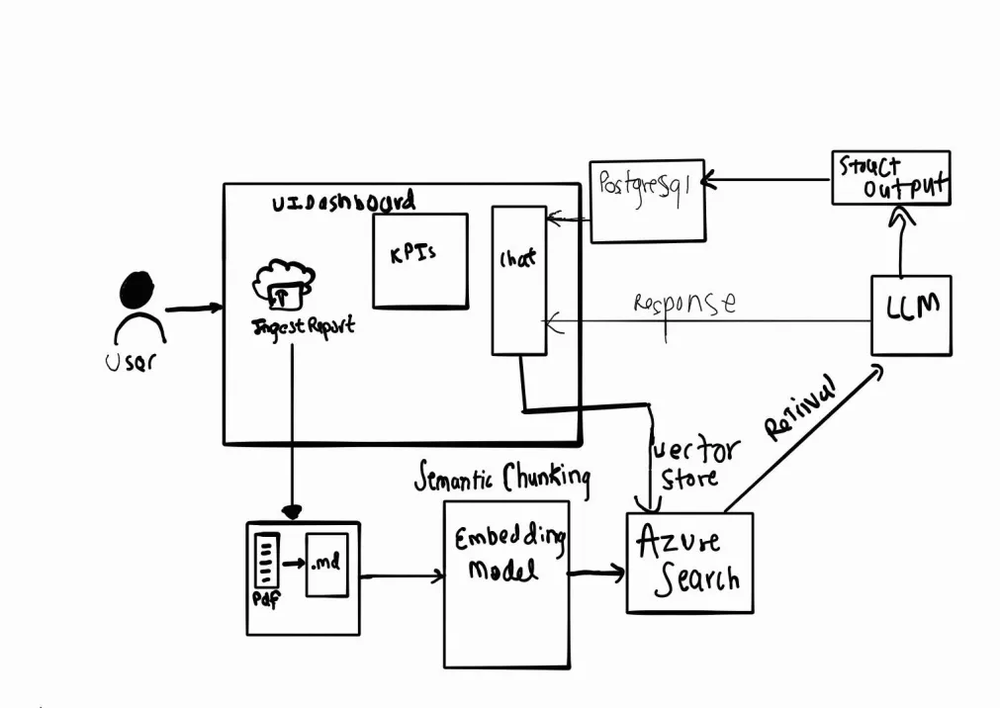
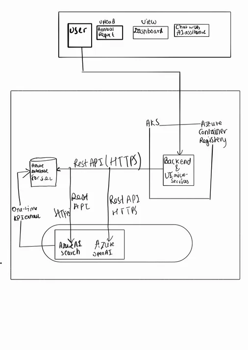
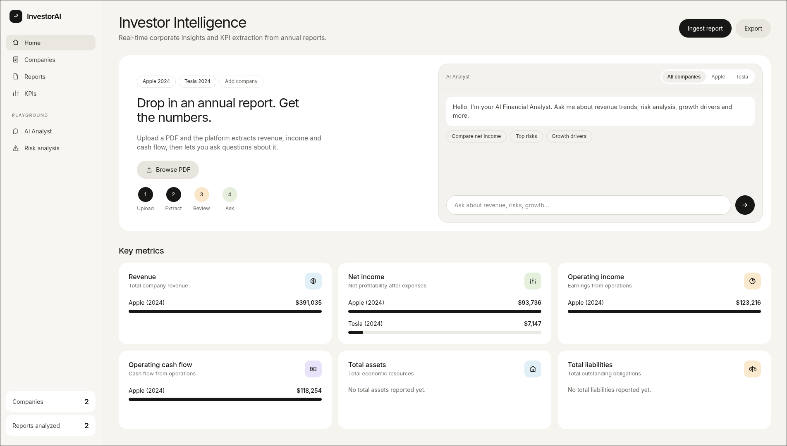
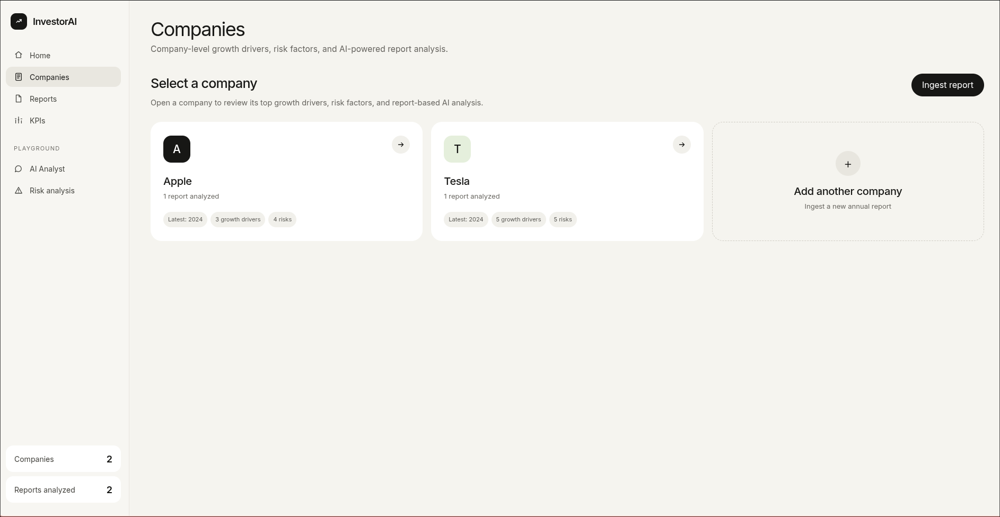

## the server will be down at Nov 19 
(Azure subscription is too expensive)

# Investor Platform

## Logical Design

## Physical design

## Website design

## Comapny design 

## AI-Powered Investor Intelligence Platform

A production-grade, cloud-native Retrieval-Augmented Generation (RAG) platform for financial analysis. It ingests company financial reports (PDFs, with OCR via Tesseract), converts them to markdown, semantically chunks the content, and embeds it into Azure AI Search for retrieval. Azure OpenAI powers both KPI extraction (structured metrics persisted to PostgreSQL) and a RAG-based chat interface for natural-language Q&A over ingested reports, surfaced through a FastAPI backend with a metrics dashboard UI.

The platform is fully containerized (Docker) and deployed to Azure Kubernetes Service (AKS), with secrets managed as Kubernetes Secrets injected at deploy time. A GitHub Actions CI/CD pipeline automates the full release flow on every push to cicd: Azure login → build and push the Docker image to Azure Container Registry (ACR) → sync environment secrets to the cluster → apply K8s manifests → rolling restart → rollout verification — giving end-to-end automated build, deploy, and health-checked rollout with no manual intervention.
